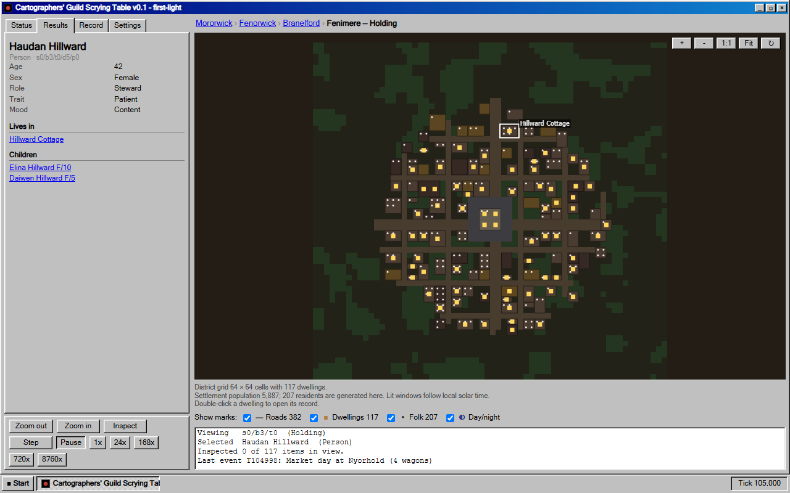

# Universe Inspector

A procedurally generated universe in a retro desktop inspection-tool window. Zoom from a field of star systems to a
planet to a settlement district, open the record of a person, and watch people age, be born, move house and die.
Web-first: TypeScript + Vite, no backend. Nine period skins, from Amiga Workbench to a modern flat one.



## Quick start

Clone and go. Nothing is installed system-wide: `setup` downloads the Node version pinned in `.nvmrc` into `./.node`
(gitignored, checksum-verified), and `run` uses it for that command only.

```
# Windows (cmd or PowerShell)          # Linux / macOS
scripts\setup.cmd                      ./scripts/setup.sh
scripts\run.cmd dev                    ./scripts/run.sh dev      # http://localhost:5173
scripts\run.cmd test                   ./scripts/run.sh test     # core invariants
scripts\run.cmd build                  ./scripts/run.sh build    # static site in dist/
```

If you already have Node 24, plain `npm ci` and `npm run dev` work too. A dev container is in `.devcontainer/`.
The dev server listens on the LAN (`server.host` in `vite.config.ts`), so a phone or laptop can open `http://<this-pc>:5173`; Windows Firewall may ask once to allow Node on the private network.

## Documentation

The documentation lives in the [Wiki](https://gitlab.com/joshg253/universe-inspector/-/wikis/home): using the
inspector, the skins, how the simulation works, the architecture, and how to develop and add things.

In this repo: [ROADMAP.md](ROADMAP.md) (ideas and deferred work), [CLAUDE.md](CLAUDE.md) (working rules for the AI
assistant that helps develop this project).

## Layout

```
src/core/      pure simulation, no DOM, no theme words (generation, towns, life, ticks)
src/packs/     content packs: vocabulary, name generators, palettes
src/worker/    runs generation + ticks off the main thread
src/ui/        window shell and skins, canvas map, charts
scripts/       setup/run (repo-local Node), selftest, screenshots
```
